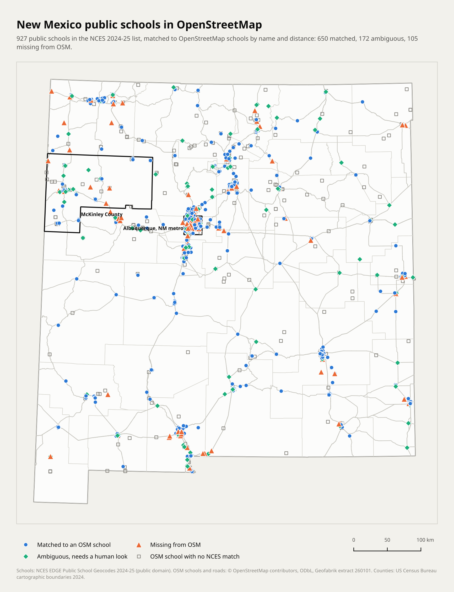
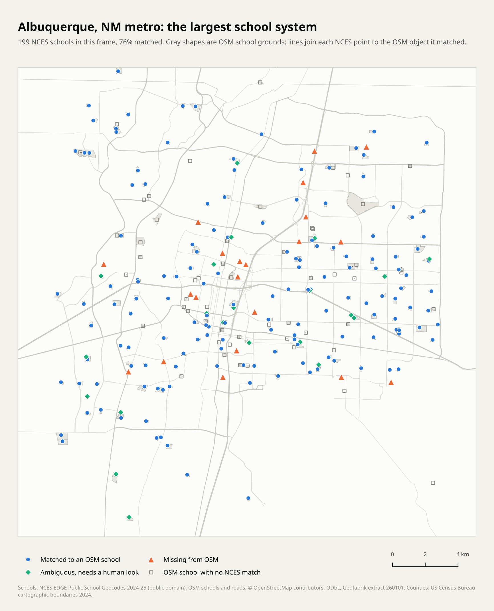
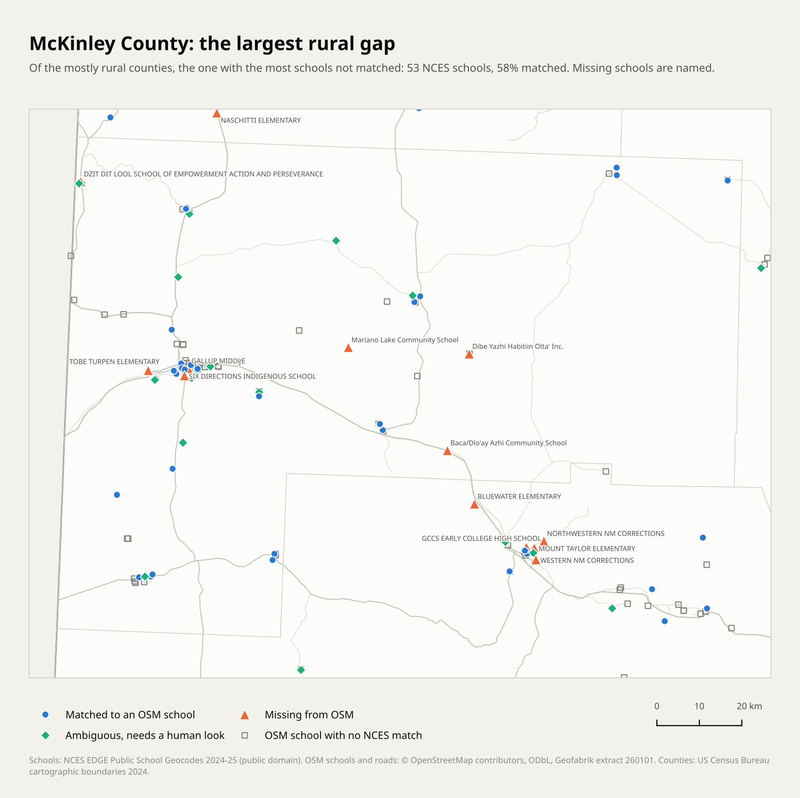

# school-conflation

Does OpenStreetMap know where every public school is? This repo answers that for New Mexico, and the
same command runs for any US state. It matches the federal list of public schools (NCES) against the
schools volunteers have mapped in OpenStreetMap, by name and by distance, and reports what matches,
what is missing, what is duplicated, and what needs a person to look at it.

The same job comes up whenever an authoritative list has to be reconciled with what is on the ground:
a facilities inventory against a parcel layer, a customer list against a store map, a permit register
against field surveys. The records almost never share an ID, the names are written differently, and
the coordinates disagree by a few meters to a few kilometers. Schools make a good public test case:
the federal list is clean and complete, OSM is uneven, and neither carries the other's ID (0 of New
Mexico's 1,372 OSM schools carry an NCES ID).



## Results for New Mexico

Of 927 public schools in the NCES 2024-25 list, 650 (70%) are matched to an OSM school, 172 (19%)
are ambiguous and go to the review queue, and 105 (11%) are missing from OSM. OSM also holds 478
school objects with no NCES match and 164 duplicates.

**Accuracy, on the 76 held-out schools** (never used for tuning; 95% Wilson intervals):

| method | precision | recall | F1 | recall once the review queue is cleared |
|---|---|---|---|---|
| hand-built matcher | **0.98** (0.91-1.00) | 0.86 (0.75-0.92) | 0.92 | **0.97** |
| Splink, same pairs | 0.92 (0.83-0.97) | 0.91 (0.81-0.96) | 0.91 | 0.91 |

On F1 the two methods are tied: the intervals overlap almost entirely at this sample size. They differ
in how they fail. Used at one threshold, Splink gives a yes or a no, so its mistakes look as sure as its matches.
The hand-built matcher sends doubtful cases to a review queue with a reason attached, so it rarely
asserts a wrong match: one false match in 56. After a person clears the queue (19% of schools), it finds
97% of the schools that are in OSM. For an inventory a client will act on, that trade is usually the
right one. Every held-out error is listed in [`results/NM/evaluation.md`](results/NM/evaluation.md).

**Findings for New Mexico**

- **Rural schools are the gap.** 80% of city schools match outright, against 62% of rural ones. Rural
  schools are the most likely to need review (25%), mostly because OSM has an unnamed outline, or one
  outline for a whole small district campus.
- **Shared campuses are the biggest source of ambiguity.** In 92 of the 172 ambiguous cases, the best OSM
  object was already claimed by another school: an elementary, middle and high school mapped as one
  "Public Schools" outline. Under a one-to-one rule only one can match, so the rest are flagged
  "shared campus?" rather than silently dropped.
- **Unnamed OSM schools: 44 ambiguous cases** are an unnamed school outline at the NCES point. Naming them
  in OSM would turn most of them into clean matches.
- **Most missing schools are truly unmapped.** For 76 of the 105, OSM has no school object within 500 m.
  About 10 are correctional, detention or online schools, which may have no campus to map.
- **OSM-only objects are mostly not public schools.** Of the 478 OSM schools with no NCES match, about 95
  have names typical of private schools (Christian, Catholic, Montessori and so on). Matching the NCES private
  school survey would likely explain many more, and is the obvious next step.

<table><tr>
<td></td>
<td></td>
</tr></table>

**Known weaknesses, left in on purpose.** Neither is fixed. Fixing one now and re-scoring on the same
held-out schools would overstate the result; a fix needs a fresh test sample.
- Token-set name similarity treats "Tatum High" as a perfect match for "Tatum Junior High School",
  because one name is contained in the other.
- An NCES point geocoded to a mailing town far from the school (Naschitti Elementary is 9 km off) is out
  of reach of any sensible blocking radius.

Output tables, one folder per state in `results/`:

| file | what it holds |
|---|---|
| `matches.csv`, `matches.gpkg` | one row per NCES school: class (matched, ambiguous, missing), the OSM object, name score, distance, overall score, and a one-line reason |
| `review_queue.csv` | the ambiguous cases, most likely matches first, which is the part a person checks |
| `osm_only.csv` | OSM schools with no NCES match (often private schools, closed schools or other tags), then the OSM duplicates |
| `evaluation.md` | precision and recall on the held-out half of the truth set, for both methods, and every error |
| `school_conflation.qgz` | the QGIS project the maps are exported from |

## How it works

1. **Ingest.** Download the pinned sources and check each against `sources.lock.json`. Filter NCES
   to the state. Pull every `amenity=school` node, way and multipolygon from the OSM extract with
   pyosmium, keeping outlines.
2. **Clean.** Normalize names: accents and punctuation stripped, abbreviations spelled out ("GOV
   BENT ELEM" and "Governor Bent Elementary School" both become "governor bent elementary"), filler
   words dropped. Flag OSM duplicates: a point inside a school outline with the same name, or an
   unnamed outline with one named point inside it (the outline then takes that name).
3. **Block.** Only OSM schools within a set radius of an NCES school are compared. Distance is
   measured to the OSM outline, so it is 0 when the NCES point falls on the school grounds.
4. **Score.** `0.7 x name similarity + 0.3 x exp(-distance / 300 m)`. Name similarity is rapidfuzz's
   token set ratio, halved when both names state a different level (Wilson Middle and Wilson
   Elementary are often next door to each other).
5. **Assign.** Greedy one-to-one: the best remaining pair first, so no OSM object is claimed twice.
   A pair at or above the threshold is matched; below it, or with a runner-up within 0.05, or with
   an unnamed OSM object, it is ambiguous; a school whose best candidate went to another school is
   ambiguous too (often a shared campus). Everything else is missing. Every row carries the reason.
6. **Evaluate.** A truth set of 150 NCES schools, sampled in proportion to the state's city,
   suburb, town and rural mix, labeled by hand against aerial imagery and school websites. It was
   split in half before any tuning: the radius and threshold were chosen on one half (500 m and
   0.56), and the numbers above come only from the other. The first evaluation showed some held-out errors
   that looked like labeling slips. So one rule-based pass was run over all 150 answers, tune and
   held-out alike. The pass itself never looked at the matcher's output, and it found 4 answers that
   broke the labeling rules (for example, a point named for the school had been passed over because it was not an
   outline). Those 4 were corrected. The import also accepts any candidate whose name is identical to
   the object chosen, since an outline and a point for the same school are both correct.
7. **Benchmark.** Splink (Fellegi-Sunter, DuckDB backend) scores exactly the same blocked pairs,
   trained without labels, with its threshold set on the same tune half.
8. **Map.** PyQGIS, headless, builds a QGIS project and exports three maps from it.

## Run it

Python 3.12. The maps need a system QGIS 3.44 LTR, because PyQGIS does not install from pip
(on Debian or Ubuntu: the `qgis` and `python3-qgis` packages from qgis.org).

```bash
python3 -m venv .venv
.venv/bin/pip install -r requirements.txt
.venv/bin/python -m conflate --state NM
```

The first run downloads about 175 MB into `data/raw/` (never committed). Without QGIS, add
`--no-maps`; everything else still runs. If QGIS's Python is not `/usr/bin/python3`, point
`--qgis-python` or `QGIS_PYTHON` at it.

Another state: `--state CO`. Its OSM extract is checked against Geofabrik's published checksum on
first download and then pinned in `sources.lock.json`. A state without its own truth set uses New
Mexico's tuned radius and threshold, and reports no precision or recall until it gets one:

```bash
.venv/bin/python -m conflate.truth sample --state CO   # draw a sample, write the labeling sheet
# label truth/CO/labeling_sheet.xlsx by hand, then:
.venv/bin/python -m conflate.truth import --state CO
.venv/bin/python -m conflate.tune --state CO
.venv/bin/python -m conflate --state CO
```

Tests (no network, no QGIS): `.venv/bin/python -m pytest`.

## Data and pinned versions

| source | version | license |
|---|---|---|
| [NCES EDGE Public School Geocodes](https://nces.ed.gov/programs/edge/Geographic/SchoolLocations) | 2024-25 | public domain |
| [OpenStreetMap](https://www.openstreetmap.org/copyright) via [Geofabrik](https://download.geofabrik.de/north-america/us.html) | extract of 2026-01-01 (Geofabrik keeps each January 1 extract permanently) | ODbL 1.0 |
| [US Census cartographic boundary files](https://www.census.gov/geographies/mapping-files/time-series/geo/cartographic-boundary.html), counties 1:500,000 | 2024 | public domain (map background only) |

## License

Code: Copyright (C) 2026 Stephen Hibpshman. This program is free software: you can redistribute it
and/or modify it under the terms of the GNU General Public License as published by the Free Software
Foundation, either version 3 of the License, or (at your option) any later version
(GPL-3.0-or-later). See `LICENSE`.

Data: the tables and GeoPackages in `results/` and the OSM IDs in `truth/` are derived from
OpenStreetMap and are made available under the
[Open Database License 1.0](https://opendatacommons.org/licenses/odbl/1-0/).
© OpenStreetMap contributors. The maps carry the same attribution.
